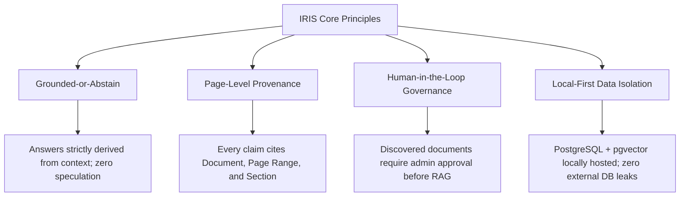
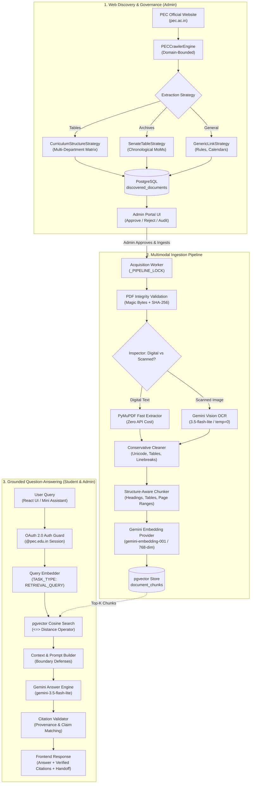
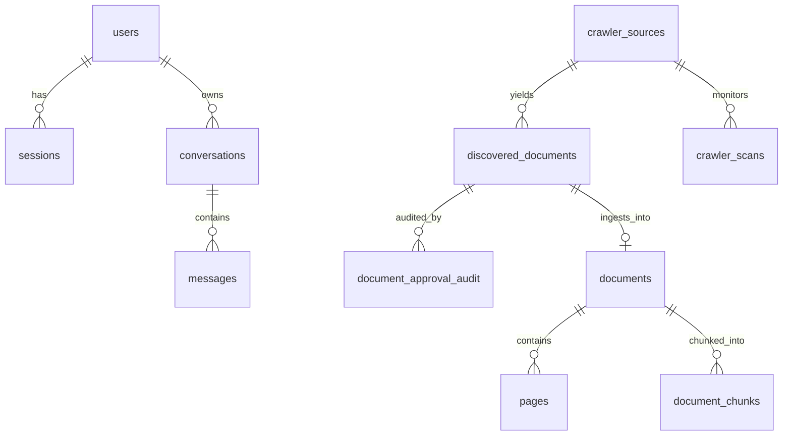

# IRIS: Institutional Retrieval & Intelligence System
## Comprehensive Architectural & Engineering Project Report

---

## 1. Executive Summary & Project Identity

**IRIS (Institutional Retrieval & Intelligence System)** is an enterprise-grade, local-first Question-Answering and Knowledge Intelligence platform purpose-built for academic institutions, piloted at **Punjab Engineering College (PEC)**. 

Historically, institutional knowledge in universities—such as undergraduate curricula, grading policies, attendance regulations, senate minutes, academic calendars, and internship guidelines—is fragmented across hundreds of static, multi-page PDF documents scattered across departmental subdomains. Students and faculty face high friction locating authoritative rules, while public large language models (LLMs) frequently hallucinate policies or fabricate non-existent regulations.

IRIS solves this fundamentally by combining:
1. **Automated Curated Web Crawling** that proactively discovers and tracks official institutional documents across university sources.
2. **Human-in-the-Loop Administrative Governance** with an immutable audit log ensuring only vetted documents enter the knowledge base.
3. **Resilient Multimodal Ingestion** pairing high-speed digital extraction with page-level Gemini Vision OCR for legacy scanned documents.
4. **Strict Grounded-or-Abstain RAG Engine** with rigorous citation validation that matches every generated claim to precise document filenames and page ranges, refusing to answer or recommending institutional handoff when evidence is insufficient.
5. **Modern Dual-Mode Interface** featuring a primary Document Management Portal for administrators, an expandable floating Mini Chat Assistant, and persistent student thread history protected by Google OAuth 2.0.

---

## 2. Problem Statement & System Motivation

```
   Traditional University Ecosystem                     IRIS Grounded Intelligence Architecture
 ┌────────────────────────────────────────┐          ┌────────────────────────────────────────┐
 │ - Hundreds of unlinked PDFs           │          │ - Automated, domain-bounded crawler    │
 │ - Silent annual syllabus revisions     │   ───►   │ - Change detection (ETag, SHA-256)     │
 │ - Hallucinating public LLMs (ChatGPT)  │          │ - Strict page-level provenance (RAG)   │
 │ - Zero accountability or citations     │          │ - 100% verifiable citations & handoffs │
 └────────────────────────────────────────┘          └────────────────────────────────────────┘
```

### 2.1 The Academic Information Crisis
- **Information Fragmentation:** Critical student rules are divided across academic rulebooks, senate meeting minutes, and annual departmental handouts. A student asking about "minimum attendance required for medical condonation" must cross-reference Senate Meeting resolutions against UG Regulations.
- **Silent Document Revisions:** Departments frequently update course schemes or calendar schedules without version notices. Outdated PDF copies circulate among students.
- **The LLM Hallucination Trap:** Generic LLMs give convincing answers that mix up rules from other universities or fabricate policies out of whole cloth, risking academic penalties for students.
- **Lack of Institutional Provenance:** In an academic setting, an answer without an exact document name and page number cannot be presented to a department dean or academic office.

### 2.2 Core Objectives of IRIS
1. **Zero Hallucination Tolerance:** Answers must be 100% grounded in official documents. If evidence is ambiguous or missing, the system must explicitly ask for clarification or recommend the appropriate administrative office.
2. **Page-Level Provenance:** Every statement must trace back to an exact source PDF, start page, and end page.
3. **Institutional Security & Privacy:** Student authentication restricted to `@pec.edu.in` accounts, local vector storage in PostgreSQL, server-side credential isolation, and strict administrative RBAC.
4. **Administrative Curation:** Institutional administrators retain ultimate authority over what enters the AI's corpus via a human-in-the-loop approval workflow.

---

## 3. Core Philosophy & Non-Negotiable Guarantees

IRIS is governed by four architectural principles:



1. **The Grounded-or-Abstain Principle:** The generator prompt is bounded by strict anti-prompt-injection delimiters. If retrieved evidence does not explicitly support the question, the engine transitions to `clarification_needed`, `insufficient_evidence`, or `handoff_recommended`.
2. **Immutable Source Provenance:** Raw PDFs in `documents/` are strictly read-only. Extracted text, cleaned Markdown, chunks, and embeddings preserve immutable references to the parent document hash and page numbers.
3. **Audit-Logged Document Lifecycle:** No discovered file is ingested automatically without explicit human administrative approval. Every transition (`discovered` → `approved` → `downloading` → `ingested`) records an immutable audit log with admin email and timestamp.
4. **Local-First, Cloud-Ready Design:** All vector similarity searches, conversation records, and user sessions reside in a local PostgreSQL container (`pgvector/pgvector:pg16`), ensuring institution data sovereignty.

---

## 4. End-to-End System Architecture



---

## 5. Technology Stack & Component Specifications

| Tier | Component | Technology Selected | Justification & Role |
|---|---|---|---|
| **Frontend** | Framework | React 18 + TypeScript | Type-safe, modular UI with rich interactive components. |
| | Build Tooling | Vite 8 | Instant HMR and optimized production bundling (1.1s build). |
| | Styling | Custom Semantic CSS + Modern Design Tokens | Clean academic identity (Navy `#1e3a8a`, Slate `#64748b`, Amber alerts). |
| | Icons | Lucide React | Consistent, accessible SVG iconography. |
| **Backend API** | Framework | FastAPI (Python 3.14) | High-performance asynchronous REST API with Pydantic validation. |
| | Server | Uvicorn + WatchFiles | Production-grade ASGI server with hot-reload capabilities. |
| | Auth & Security | Google Identity Services + itsdangerous | Institutional OAuth 2.0 with HTTP-only signed session cookies. |
| **Data & Vectors** | Database | PostgreSQL 16 (`pgvector`) | Reliable relational data with integrated vector search in one engine. |
| | ORM | SQLAlchemy 2.0 | Explicit relational modeling, session scopes, and row-level locks. |
| | Migrations | Alembic | Fully versioned, deterministic database schema evolution. |
| **AI & NLP** | Embeddings | `gemini-embedding-001` (768-dim) | High semantic density with explicit document/query task-type tuning. |
| | Generation | `gemini-3.5-flash-lite` | Ultra-fast, cost-effective reasoning with `3.1-flash-lite` fallback. |
| | Multimodal OCR | Gemini Vision API | Verbatim page transcription for scanned PDF archives. |
| **Document Processing** | PDF Parsing | PyMuPDF (`fitz`) | Fast local digital text extraction, rendering, and page inspection. |
| | Web Scraping | HTTPX + BeautifulSoup4 | Domain-bounded, respectful crawling with HTTP header inspection. |

---

## 6. Detailed Subsystems & Engineering Implementation

### 6.1 Subsystem A: Curated Web Crawler & Matrix Discovery Engine
- **Strict Boundary Enforcement:** `is_pec_domain()` validates hostnames against `pec.ac.in` and subdomains, preventing boundary escapes or external URL injection.
- **Curriculum Matrix Traversal (`CurriculumStructureStrategy`):** Official programme matrices (such as `https://pec.ac.in/programmes/ug/structure`) display a multi-department table where 2023/2024 schemes link to department landing subpages (e.g. `/structure/cse-ai-syllabus`). The strategy crawls subpages, extracts nested PDF download links, and maps them to descriptive discipline titles (e.g., *Computer Science & Engineering (AI) (2023 Batch Onwards)*).
- **Multi-Factor Change Detection:** Without downloading full files, the engine issues lightweight HTTP `HEAD` requests to track remote `ETag`, `Last-Modified`, and `Content-Length` headers, comparing them against the database to flag `potentially_changed` documents.

### 6.2 Subsystem B: Human-in-the-Loop Governance & Audit Trail
```
 [Discovered] ──► [Approved] ──► [Downloading] ──► [Ingested]
      │              │                  │               │
      ▼              ▼                  ▼               ▼
  [Rejected]     [Reconsider]    [Download Failed] [Ingest Failed]
```
- **State Machine:** Formally enforced statuses prevent race conditions.
- **Row-Level Concurrency Locking:** `with_for_update()` on database records ensures concurrent administrative actions never duplicate downloads or pipeline runs.
- **Immutable Audit History:** The `document_approval_audit` table logs every status transition, the acting admin's email, timestamp, previous status, new status, and optional justification reasons.

### 6.3 Subsystem C: Durable Multimodal Ingestion Pipeline
- **Hybrid Extraction Routing:** PyMuPDF classifies each page as `predominantly_digital` (extracted in milliseconds with zero API cost) or `predominantly_scanned` (routed to Gemini Vision OCR).
- **Verbatim Transcription Prompting:** OCR uses temperature 0 with explicit instructions: *"Transcribe all printed and handwritten English text exactly as written. Preserve all Markdown tables, course codes, and numeric percentages. Do not summarize or embellish."*
- **Conservative Cleaner:** Normalizes broken line-wrap hyphens (`atten-` + `dance` → `attendance`), non-standard bullets, and irregular whitespace while strictly preserving Markdown tables, section titles, and dates.
- **Structure-Aware Chunking:** Chunks are split along natural structural breaks (Markdown headings `#`, `##`, section headers, and paragraph boundaries) with configurable token targets (avg. 500–600 tokens), atomic table preservation, and exact page span logging (`start_page`, `end_page`).

### 6.4 Subsystem D: Grounded RAG Generator & Citation Validator
- **Boundary Defense:** Injected context is isolated within `<INSTITUTIONAL_DOCUMENT_CONTEXT>` boundary tags with strict instructions to disregard conflicting user system prompt injection attempts.
- **Four Distinct Response Statuses:**
  - `answered`: Complete, grounded answer with verifiable citations.
  - `clarification_needed`: Query is ambiguous (e.g., student asks "when are midterms?" without specifying semester or year).
  - `insufficient_evidence`: Knowledge base lacks the necessary facts to answer safely.
  - `handoff_recommended`: Matters requiring formal administrative action (e.g., fee waivers, disciplinary appeals, medical condonation) provide official office contact details.
- **Zero-Fabrication Citation Validator:** The backend verifies that every citation in the response matches an actual chunk retrieved during the semantic search. Fabricated or hallucinatory file references are stripped before delivery to the frontend.

### 6.5 Subsystem E: Dual-Mode User Interface
- **Primary Admin Document Portal:** Administrators land directly on a full-screen, high-density catalogue view with horizontal filtering (Source, Status, Change Detection, Search), multi-directional sorting (Newest by Issued Date, Oldest, Title), batch actions (Approve All, Ingest All), and live stats.
- **Floating Quarter-Size Mini Assistant:** A toggleable floating assistant panel allows administrators to test grounded RAG queries against newly ingested files without leaving the management portal.
- **Student Chat View:** Clean, distraction-free conversational experience with suggested questions, expandable citation cards, and conversation history.

---

## 7. Database Architecture & Alembic Migrations

The database schema is managed via 9 versioned Alembic migrations:



| Migration Version | File | Schema Alterations & Impact |
|---|---|---|
| **0001** | `0001_enable_vector_extension.py` | Activates PostgreSQL `vector` extension. |
| **0002** | `0002_create_documents_and_pages.py` | Creates `documents` (filename, sha256, status) and `pages` (page_number, extracted_text, extraction_method). |
| **0003** | `0003_add_cleaned_text_to_pages.py` | Adds `cleaned_text` and `cleaning_version` to `pages`. |
| **0004** | `0004_create_document_chunks.py` | Creates `document_chunks` with `chunk_text`, `start_page`, `end_page`, and `embedding vector(768)`. |
| **0005** | `0005_add_auth_and_conversations.py` | Creates `users`, `sessions`, `conversations`, and `messages` tables for Google OAuth. |
| **0006** | `0006_add_crawler_tables.py` | Creates `crawler_sources`, `discovered_documents`, and `crawler_scans`. |
| **0007** | `0007_add_crawler_approval_and_audit.py` | Creates `document_approval_audit` table and adds rejection reasons. |
| **0008** | `0008_add_crawler_scan_concurrency_index.py` | Adds partial index preventing concurrent running crawler scans. |
| **0009** | `0009_add_crawler_ingestion_columns.py` | Adds `local_filename`, `error_message`, and `ingested_document_id` foreign key. |

---

## 8. Milestone Progression Summary (M0 — M16)

```
 M0: Environment & pgvector  ──►  M1: PDF Discovery/Inspection  ──►  M2: Resumable Gemini OCR
                                                                             │
 M5: Embedding Repo Found.   ◄──  M4: Structure-Aware Chunking ◄──  M3: Text Cleaning & Metadata
        │
        ▼
 M6: Gemini 768-dim Vectors  ──►  M7: Cosine Retrieval & Eval  ──►  M8: Grounded RAG Generator
                                                                             │
 M11: Google OAuth & History ◄──  M10: React UI & Citations     ◄──  M9: FastAPI REST Backend
        │
        ▼
 M12: Curated PEC Web Crawler ─►  M13: Human-in-Loop Approval  ──►  M14: Resilient Acquisition
                                                                             │
 M16: Matrix Strategy & Tests ◄── M15: Portal UI & Chrono Sort  ◄────────────┘
```

- **M0 — Environment & Database:** Docker Compose `iris-postgres`, Alembic migrations, database connectivity tests.
- **M1 — PDF Inspection:** SHA-256 hashing, digital vs. scanned page classification.
- **M2 — Page Extraction & Resumable OCR:** PyMuPDF digital parser, Gemini Vision OCR adapter, crash-resilient per-page commits.
- **M3 — Cleaning & Metadata:** Conservative text normalizer, non-blocking metadata classifier.
- **M4 — Structure-Aware Chunking:** Heading/table preservation, page range provenance.
- **M5 & M6 — Embeddings:** 768-dimensional `gemini-embedding-001` integration with batching.
- **M7 — Semantic Retrieval:** Cosine distance `<=>` search, Hit@1 88%, Hit@5 100% on curated benchmark questions.
- **M8 — RAG Answer Engine:** Grounded prompt defense, 4-status response taxonomy, citation validator.
- **M9 — FastAPI Backend:** REST endpoints (`/chat`, `/health`), Pydantic validation, CORS middleware.
- **M10 — React Frontend:** Vite-powered modern web UI, citation inspection cards, suggested queries.
- **M11 — Auth & Conversation History:** Google OAuth 2.0 (`@pec.edu.in`), HttpOnly signed session cookies, thread history.
- **M12 — Web Discovery & Change Detection:** `PECCrawlerEngine`, ETag/Last-Modified tracking, 7 PEC sources.
- **M13 — Human-in-the-Loop Governance:** Approval state machine, immutable audit logging, admin RBAC.
- **M14 — Acquisition Pipeline:** Magic-byte PDF integrity check, `_PIPELINE_LOCK` serialization, restart crash recovery.
- **M15 — Admin UI Overhaul:** Document Portal as primary admin view, floating Mini Assistant, issued date sorting.
- **M16 — Deep Matrix Crawling & Test Isolation:** `CurriculumStructureStrategy` uncovering all 2023/2024 degree schemes; automated `iris_test_db` pytest isolation.

---

## 9. Current Verified Production Metrics

### 9.1 Corpus Statistics (as of November 2026)
- **Discovered Catalogue Documents:** **129 documents**
- **Durably Ingested Documents:** **35 documents**
- **Total Ingested Pages:** **1,125 pages**
- **Total Chunks in pgvector:** **894 chunks**
- **Embedded Ratio:** **100.0% (894 / 894 chunks embedded)**

### 9.2 Key Ingested Documents
1. **Curriculum Schemes:**
   - Computer Science & Engineering (DS) 2023 Batch Onwards (180 pages, 142 chunks)
   - Computer Science & Engineering (AI) 2023 Batch Onwards (156 pages, 120 chunks)
   - Computer Science & Engineering (DS) 2022 Batch (83 pages, 64 chunks)
   - CSE 2024 Syllabus Scheme (174 pages, 151 chunks)
   - UG Curriculum 2023 Volumes 1 & 2 (205 pages, 160 chunks)
2. **Institutional Governance & MoMs:**
   - Senate Meetings 96 through 109 (full minutes covering 2022–2025)
   - Deans & Heads Committee Minutes (2025–2026)
3. **Academic Policies:**
   - B.Tech & M.Tech Placement and Internship Policies (2023–2024)
   - Academic Calendars (2025–26 Even Semester & 2026–27 Odd Semester)
   - UG Rules & Procedures Manuals and SWAYAM MOOCs Guidelines

### 9.3 Automated Test Quality Assurance
- **Backend Pytest Suite:** **46 / 46 passed (100%)**
- **Frontend Vitest Suite:** **60 / 60 passed (100%)**
- **Test Database Isolation:** 100% verified (`iris_test_db` absorbs test runs with 0 writes to `iris_db`).
- **Production Bundle:** `npm run build` succeeds with zero TypeScript errors.

---

## 10. Security, Privacy & Reliability Hardening

1. **Email Domain Boundary:** Authentication strictly limits login to `@pec.edu.in` accounts, rejecting external Google accounts.
2. **Server-Side Session Security:** Tokens are random 32-byte cryptographically secure strings stored as SHA-256 hashes in PostgreSQL; cookies are `HttpOnly`, `SameSite=Lax`, and signed.
3. **Admin Privilege Verification:** Administrator endpoints verify the user's role and cross-check against the server's `ADMIN_EMAILS` environment configuration on every request.
4. **Prompt Injection Boundary:** All document content is wrapped inside explicit structural context XML tags. The system prompt instructs the model to ignore any instructions found within the document text.
5. **Acquisition Crash Recovery:** If the backend server restarts while a document is downloading or ingesting, the startup lifecycle hook (`recover_stale_ingestions_on_startup`) resets orphaned records to `download_failed`, preventing 409 Conflict deadlocks and enabling immediate retry.
6. **Isolated Test Database:** Pytest runs dynamically rebind the engine to `iris_test_db`, preventing test mocks from polluting the live administrative catalogue.

---

## 11. How to Run & Operate the System

### 11.1 Infrastructure Setup
Ensure local Docker Compose is running PostgreSQL + pgvector:
```powershell
docker compose up -d
```

### 11.2 Terminal 1: Backend API (FastAPI)
```powershell
cd d:\IRIS
.\.venv\Scripts\python.exe -m uvicorn api.main:app --host 127.0.0.1 --port 8000 --reload
```
- API Docs: `http://127.0.0.1:8000/docs`
- Health Probe: `http://127.0.0.1:8000/health`

### 11.3 Terminal 2: Frontend Web Portal (React + Vite)
```powershell
cd d:\IRIS\frontend
npm run dev
```
- Web Application: `http://127.0.0.1:5173`

### 11.4 Running Test Suites
```powershell
# Backend Test Suite (runs in isolated iris_test_db)
.\.venv\Scripts\python.exe -m pytest tests/test_crawler.py tests/test_crawler_approval.py tests/test_crawler_ingestion.py

# Frontend Test Suite
npm --prefix frontend test -- --run
```

---

## 12. Conclusion & Future Roadmap

IRIS has successfully evolved from a local RAG prototype into a robust institutional intelligence engine with automated discovery, strict human governance, multimodal document extraction, and verified citations. 

### Future Horizons
- **Google Drive Synchronizer:** Direct connector to academic office Google Drive folders for automated notice indexing.
- **Hybrid Retrieval (BM25 + Dense Vectors):** Integrating reciprocal rank fusion (RRF) for specialized acronym lookups and course codes.
- **Multilingual Support:** Hindi language transcription and query translation for multi-lingual institutional circulars.
- **Containerized Production Deployment:** Kubernetes / Docker Swarm deployment with dedicated Celery/Redis background worker nodes for continuous corpus OCR.
